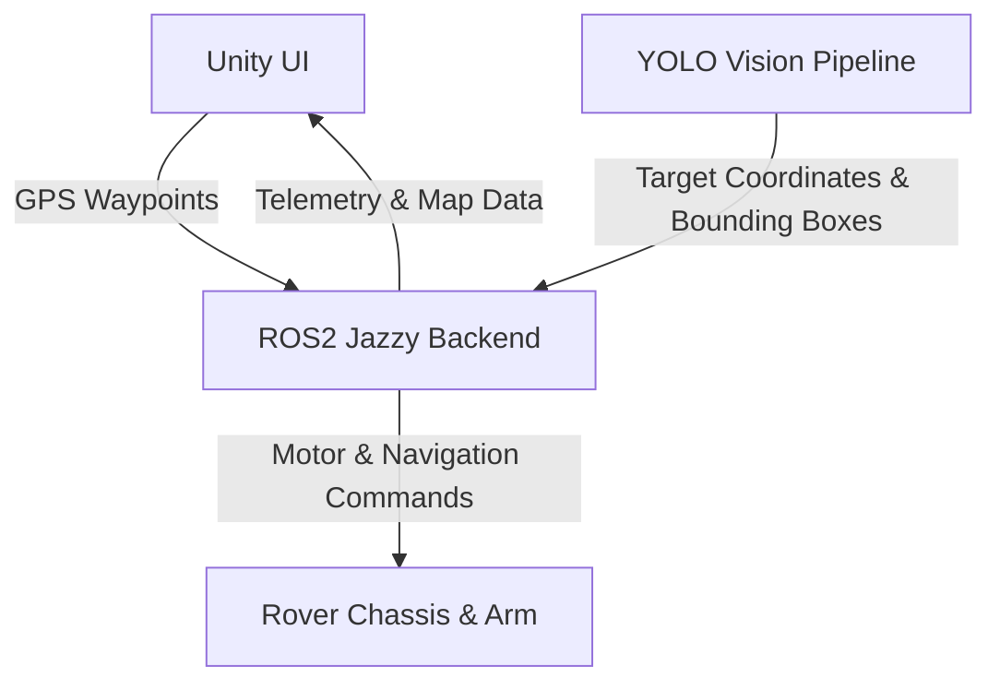

# Design

## Overview
ROS2 Rover software built by a wide range of teams. Our focus this term is the navigation and autonomy stack, which enables the rover to travel to GPS locations, find ARuCo tags, use computer vision to identify a specific hammer, and respond to gesture controls from an astronaut in an EVA suit. (Requirements: docs/requirements.md)

## Architecture

## Interfaces
    - ROS2 to Unity: UI communicating with ROS2 to get the real time coordinates and orientation of the rover and sending GPS locations for the rover to navigate to

    - Computer Vision Models to ROS2: ROS2 manages and stitches together frames from the many cameras and runs them through computer vision, the resulting computer vision scores determine where the rover navigates to.

## Data
    - Waypoints and GPS communicated between the Unity UI and ROS2 navigation
    - POSE message sent to the arm capstone of where the computer vision has located the object and how the rover has navigated to it.

## Deployment
    - By week 10 the nav autonomy functions should be complete and updated from the previous version of ROS2. The system should be able to successfully run on the rover's hardware and be able to navigate to given GPS points and there should be a working base of a Unity UI and Computer vision model.
    - Production: The completed code will be stored in the DAM Robotics Github and is owned by the Dam Robotics club, this milestone and progess was agreed upon with our project sponsor Jared Northrop.
    - Rollback: The previous years code will be available to fall back to if absolutely necessary

## Open questions
    - Is the scope of this project too large for just the 3 of us to be able to finish within the given timeframes

## Deferred decisions
    - What library or model we will use for gesture controls. We will first implement the Nav Stack and Computer Vision models before going for the extra points for gesture controls.